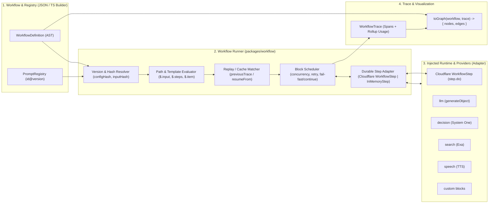

# `packages/workflow` Implementation Plan

## Goal Description

데이터(JSON 또는 DB에 저장된 구조화된 문서)를 통해 LLM 및 AI 파이프라인의 실행 흐름을 제어하고, **각 노드/프롬프트의 버전 관리**, **중간 결과(Input/Output) 확인**, **이전 실행 결과를 재사용하는 부분 재실행(Partial Re-run / Replay)**, 그리고 **노드·병렬 아이템 단위의 토큰 소모량·비용·소요 시간 추적(Span Trace)**을 제공하는 순수 코어 패키지 `packages/workflow` (`workflow`)를 구축합니다.

> [!IMPORTANT]
> **핵심 아키텍처 원칙 (인터뷰 합의 사항)**
>
> 1. **순수 코어 패키지**: `packages/workflow`는 외부 AI SDK(`ai-services`, `@openrouter/sdk` 등), DB(Drizzle), UI(`@xyflow/react`)에 직접 의존하지 않으며 `zod`만 런타임 의존성으로 가집니다.
> 2. **구조화된 Step/Block 트리(AST)**: `sequence`, `map`(리스트 병렬 처리), `parallel`(정적 동시 분기), `if`(조건 분기), `transform`(데이터 가공) 제어 블록과 `llm`, `decision`, `search`, `speech`, `custom` 실행 블록으로 계층적 파이프라인을 표현합니다.
> 3. **노드·프롬프트 버전 관리 및 부분 재실행**: 프롬프트/템플릿 레지스트리 참조(`ref: "extract-questions@v1"`)와 인라인 정의(`version` 태그 + 결정론적 SHA-256 `configHash`)를 모두 지원하며, 이전 트레이스의 스냅샷을 주입해 변경되지 않은 상위 노드의 중간 결과를 캐시(`cached`)로 재사용할 수 있습니다.
> 4. **기본 Span 트레이스 및 순수 그래프 변환(`toGraph`)**: 각 노드 및 `map` 내부 개별 아이템의 입출력, 렌더링된 프롬프트, 토큰/비용(`Usage`), 소요 시간(`durationMs`), 상태를 계층적 Span으로 기록하고, UI에서 즉시 시각화할 수 있도록 `{ nodes, edges }`로 변환하는 순수 함수 `toGraph`를 제공합니다.

---

## Architecture Overview



---

## Proposed Changes

### Package Configuration (`packages/workflow`)

기존 `packages/ai`, `packages/editor`와 동일한 Vite+ 모노레포 규칙(`tsconfig.base.json`, `vite-plus`)을 따릅니다.

#### [NEW] [package.json](file:///Users/sangjun/Documents/agent-craft/packages/workflow/package.json)

- 패키지 이름: `"workflow"`
- Exports:
  - `"."`: `./src/index.ts`
  - `"./schema"`: `./src/schema.ts`
  - `"./runner"`: `./src/runner.ts`
  - `"./builder"`: `./src/builder.ts`
  - `"./graph"`: `./src/graph.ts`
- Dependencies: `"zod": "catalog:"`
- DevDependencies: `"@types/node": "catalog:"`, `"typescript": "catalog:"`, `"vite-plus": "catalog:"`

#### [NEW] [tsconfig.json](file:///Users/sangjun/Documents/agent-craft/packages/workflow/tsconfig.json)

- `../../tsconfig.base.json` 확장, `target: "esnext"`, `module: "nodenext"`.

---

### 1. Schema, AST & Versioning (`packages/workflow/src/schema.ts` & `hash.ts`)

워크플로우 JSON 정의와 프롬프트 버전 레지스트리를 검증하는 Zod 스키마 및 타입을 정의합니다.

#### [NEW] [schema.ts](file:///Users/sangjun/Documents/agent-craft/packages/workflow/src/schema.ts)

- **공통 블록 메타데이터 (`BlockBase`)**:
  - `id: string` (워크플로우 내 고유 식별자, 예: `"extract"`, `"generate-twin"`)
  - `label?: string` (표시 이름)
  - `version?: string | number` (명시적 노드 버전, 예: `"v1"`, `1`)
  - `retry?: { maxAttempts: number; backoffMs?: number; backoff?: "constant" | "linear" | "exponential" }`
  - `timeoutMs?: number` (Cloudflare Workflow `step.do` timeout 연동 및 자체 실행 타임아웃)
- **프롬프트 템플릿 및 버전 참조 (`PromptTemplate`, `PromptRef`)**:
  - 레지스트리에 등록 가능한 버전 관리 단위:
    ```ts
    export type PromptTemplate = {
      id: string;
      version: string | number;
      model?: string;
      prompt: PromptTemplateContent; // string 또는 멀티모달 파트 배열 (text + image_url)
      outputSchema?: JsonSchema;
      reasoningEffort?: "low" | "medium" | "high";
      temperature?: number;
    };
    ```
  - `llm` 블록은 `ref: "extract-questions@v1"` 형태로 템플릿을 참조하거나 인라인으로 `model`, `prompt`, `outputSchema`를 정의할 수 있으며, 인라인 오버라이드도 지원합니다.
- **제어 블록 (Control Blocks)**:
  - `SequenceBlock`: `{ type: "sequence", steps: WorkflowBlock[] }`
  - `MapBlock` (리스트 병렬 처리):
    ```ts
    export type MapBlock = BlockBase & {
      type: "map";
      /** 예: "$.steps.extract.questions" */
      items: string;
      concurrency?: number;
      onError?: "fail-fast" | "continue";
      step: WorkflowBlock;
    };
    ```
  - `ParallelBlock` (정적 동시 분기):
    ```ts
    export type ParallelBlock = BlockBase & {
      type: "parallel";
      concurrency?: number;
      onError?: "fail-fast" | "continue";
      branches: WorkflowBlock[];
    };
    ```
  - `IfBlock` (조건 분기):
    ```ts
    export type IfBlock = BlockBase & {
      type: "if";
      condition: ConditionExpr;
      then: WorkflowBlock;
      else?: WorkflowBlock;
    };
    ```
  - `TransformBlock` (데이터 매핑/추출):
    - `{ type: "transform", value: DataBindingValue }` (경로 추출, 객체/배열 재구성, 템플릿 조합)
- **AI 및 액션 실행 블록 (Action Blocks)**:
  - `LlmBlock`: `{ type: "llm", ref?: string, model?: string, prompt?: PromptTemplateContent, outputSchema?: JsonSchema, reasoningEffort?: "low" | "medium" | "high", temperature?: number }`
  - `DecisionBlock` (System One): `{ type: "decision", state: PromptTemplateContent, questions: Record<string, DecisionQuestionTemplate> }`
  - `SearchBlock` (Exa): `{ type: "search", query: string, numResults?: number, text?: boolean | { maxCharacters: number }, highlights?: boolean }`
  - `SpeechBlock` (TTS): `{ type: "speech", turns: Array<{ voice: string; text: string; instructions?: string }> }`
  - `CustomBlock`: `{ type: "custom", handler: string, input?: unknown }`
- **워크플로우 최상위 정의 (`WorkflowDefinition`)**:
  ```ts
  export type WorkflowDefinition = {
    id: string;
    name: string;
    version: string | number;
    description?: string;
    inputSchema?: JsonSchema;
    prompts?: PromptTemplate[]; // 워크플로우 내장 프롬프트 버전 목록 (외부 레지스트리와 병합 가능)
    root: WorkflowBlock;
  };
  ```

#### [NEW] [hash.ts](file:///Users/sangjun/Documents/agent-craft/packages/workflow/src/hash.ts)

- 객체 키를 정규화(canonical JSON)하여 Web Crypto API(`crypto.subtle.digest("SHA-256", ...)`)로 결정론적 해시를 생성하는 `computeHash(value: unknown): Promise<string>` 제공.
- 노드의 실제 실행 설정(해석된 프롬프트 템플릿 버전, 모델, 출력 스키마 등)으로부터 `configHash`를 계산하고, 노드에 들어가는 평가된 입력으로부터 `inputHash`를 계산합니다.

---

### 2. Expressions, Templates & JSON Schema Validation (`packages/workflow/src/expression.ts` & `json-schema.ts`)

코드 실행(`eval`) 없이 안전하게 데이터 바인딩과 조건식을 평가합니다.

#### [NEW] [expression.ts](file:///Users/sangjun/Documents/agent-craft/packages/workflow/src/expression.ts)

- **실행 컨텍스트 (`EvalContext`)**:
  - `input`: 워크플로우 초기 입력
  - `steps`: 완료된 노드들의 `id -> output` 맵 (현 스코프 기준: `map` 내부에서는 해당 아이템 스코프의 로컬 `steps`가 상위 `steps`를 섀도잉)
  - `item`: 현재 `map` 반복의 원소
  - `index`: 현재 `map` 반복의 인덱스(`number`)
- **경로 참조 (`resolvePath`)**:
  - `"$.input.image"`, `"$.steps.extract.questions"`, `"$.item.number"`, `"$.index"`, 배열 인덱스(`$.steps.extract.questions[0]`) 및 `.length` 속성 접근 지원.
- **문자열 템플릿 보간 (`renderTemplate`)**:
  - `"{{item.number}}번 문항의 쌍둥이 문항을 생성해줘"` -> 컨텍스트 값으로 치환 (객체/배열인 경우 JSON 직렬화).
  - 단일 참조 문자열(`"$.input.image"` 또는 `"{{input.image}}"`)을 데이터 바인딩에서 사용할 때 원본 타입(숫자, 배열, 객체 등)을 유지하는 `resolveValue(template, ctx)` 지원.
- **조건식 평가 (`evaluateCondition`)**:
  - 비교 연산자: `eq`, `neq`, `gt`, `gte`, `lt`, `lte`, `in`, `contains`, `exists`
  - 논리 연산자: `{ and: ConditionExpr[] }`, `{ or: ConditionExpr[] }`, `{ not: ConditionExpr }`

#### [NEW] [json-schema.ts](file:///Users/sangjun/Documents/agent-craft/packages/workflow/src/json-schema.ts)

- JSON으로 정의된 `outputSchema` / `inputSchema` (JSON Schema 서브셋: `object`, `array`, `string`, `number`, `integer`, `boolean`, `enum`, `const`, `required`, `additionalProperties`, `anyOf`/`oneOf`)를 검증하는 경량 검증기 `validateJsonSchema(schema, data)` 및 TS 작성 시 Zod 스키마를 JSON Schema로 변환하는 `fromZod(zodSchema)` 헬퍼 제공.

---

### 3. Trace, Cloudflare `WorkflowStep` & Provider Interfaces (`packages/workflow/src/types.ts`)

외부 AI 서비스 및 Cloudflare 런타임 타입에 직접 결합되지 않으면서도 Cloudflare Workflows의 `WorkflowStep`을 그대로 주입받을 수 있는 구조적 인터페이스(Structural Typing)와 Span 트레이스 구조를 정의합니다.

#### [NEW] [types.ts](file:///Users/sangjun/Documents/agent-craft/packages/workflow/src/types.ts)

- **Cloudflare Workflows `step` 호환 인터페이스 (`WorkflowStepRunner`)**:
  - Cloudflare Workers의 `WorkflowStep` (`step.do(name, callback)` / `step.do(name, config, callback)`)과 시그니처가 100% 호환되는 덕 타이핑(structural typing) 인터페이스:
    ```ts
    export type WorkflowStepRetryConfig = {
      limit: number;
      delay: string | number;
      backoff?: "constant" | "linear" | "exponential";
    };

    export type WorkflowStepConfig = {
      retries?: WorkflowStepRetryConfig;
      timeout?: string | number;
    };

    /**
     * Cloudflare Workflows의 `WorkflowStep` 인스턴스를 어댑터 없이 그대로 주입할 수 있는 인터페이스.
     */
    export interface WorkflowStepRunner {
      do<T>(name: string, callback: () => Promise<T>): Promise<T>;
      do<T>(name: string, config: WorkflowStepConfig, callback: () => Promise<T>): Promise<T>;
      sleep?(name: string, duration: string | number): Promise<void>;
    }
    ```
- **토큰 및 비용 (`WorkflowUsage`)**:
  - `{ inputTokens: number; outputTokens: number; cost: number }`
  - `sumUsage(usages)` 유틸리티 제공.
- **계층적 Span (`NodeSpan`) 및 `WorkflowTrace`**:
  ```ts
  export type SpanStatus = "pending" | "running" | "done" | "cached" | "skipped" | "error";

  export type NodeSpan = {
    spanId: string;
    parentSpanId?: string;
    nodeId: string;
    /** Cloudflare Workflow step.do에 전달된 고유 스텝 이름 (예: "extract@v1#a1b2c3d4" 또는 "generate-twins[0]/twin-item@v1#e5f6g7h8") */
    stepKey?: string;
    nodeType: WorkflowBlock["type"];
    label?: string;
    /** 명시적 버전 태그 (예: "v1") 또는 참조된 프롬프트 버전 */
    version?: string | number;
    /** 참조된 프롬프트 식별자 (예: "extract-questions@v1") */
    promptRef?: string;
    /** 노드 설정(프롬프트+모델+스키마 등)의 결정론적 해시 */
    configHash: string;
    /** 평가된 입력 데이터의 결정론적 해시 (부분 재실행 캐시 매칭용) */
    inputHash?: string;
    /** map 블록 내부 반복인 경우 인덱스 */
    iterationIndex?: number;
    status: SpanStatus;
    startedAt: number;
    finishedAt?: number;
    durationMs?: number;
    input?: unknown;
    /** LLM 등에 실제 렌더링되어 전달된 요청 페이로드 (프롬프트 디버깅용) */
    renderedRequest?: unknown;
    output?: unknown;
    usage?: WorkflowUsage;
    attempts?: number;
    error?: string;
    children: NodeSpan[];
  };

  export type WorkflowTrace = {
    runId: string;
    workflowId: string;
    workflowVersion: string | number;
    status: "running" | "done" | "error";
    startedAt: number;
    finishedAt?: number;
    durationMs?: number;
    input: unknown;
    output?: unknown;
    usage: WorkflowUsage;
    rootSpan: NodeSpan;
    /** nodeId별 최종 출력 스냅샷 */
    stepOutputs: Record<string, unknown>;
    error?: string;
  };
  ```
- **추상 프로바이더 인터페이스 (`WorkflowProviders`)**:
  - `llm?: (request: LlmProviderRequest, signal?: AbortSignal) => Promise<{ output: unknown; usage?: WorkflowUsage }>`
  - `decision?: (request: DecisionProviderRequest, signal?: AbortSignal) => Promise<{ answers: Record<string, unknown>; usage?: WorkflowUsage }>`
  - `search?: (request: SearchProviderRequest, signal?: AbortSignal) => Promise<{ results: unknown[]; usage?: WorkflowUsage }>`
  - `speech?: (request: SpeechProviderRequest, signal?: AbortSignal) => Promise<{ audio: Uint8Array | string; usage?: WorkflowUsage }>`
  - `custom?: Record<string, (input: unknown, ctx: CustomBlockContext) => Promise<{ output: unknown; usage?: WorkflowUsage }>>`

---

### 4. Execution Engine, Cloudflare `step` Integration & Partial Re-run (`packages/workflow/src/runner.ts`)

워크플로우 AST를 순회하며 Cloudflare `WorkflowStep`(`step.do`) 위임, 제어 흐름, 동시성 제한, 재시도, 부분 재실행 캐시, 실시간 트레이스 스트리밍을 수행합니다.

#### [NEW] [runner.ts](file:///Users/sangjun/Documents/agent-craft/packages/workflow/src/runner.ts)

- **`runWorkflow(workflow, options)`**:
  - **옵션 (`RunWorkflowOptions`)**:
    - `input: unknown`
    - `providers: WorkflowProviders`
    - `step?: WorkflowStepRunner` (**Cloudflare Workflow의 `step` 객체 주입**. 미주입 시 인메모리 Step Runner로 동작)
    - `prompts?: PromptTemplate[]` (외부 주입 프롬프트 레지스트리)
    - `previousTrace?: WorkflowTrace` (부분 재실행을 위한 이전 트레이스 주입)
    - `resumeFrom?: string` (특정 `nodeId` 이전의 상위 노드들은 강제 캐시 재사용 또는 `seedOutputs` 주입)
    - `seedOutputs?: Record<string, unknown>` (특정 노드의 중간 결과를 직접 덮어써서 하위 파이프라인만 실험)
    - `onTraceUpdate?: (trace: WorkflowTrace) => void` (Cloudflare Agent `state.live` 등에 실시간 푸시)
    - `onEvent?: (event: WorkflowEvent) => void`
    - `signal?: AbortSignal`
  - **Cloudflare `step.do` 통합 동작 방식**:
    1. **결정론적 Step Key 생성**: 각 실행 블록(`llm`, `decision`, `search`, `speech`, `custom`)은 트리 내 경로, `map` 반복 인덱스, 버전, `configHash`를 조합한 결정론적 이름(예: `"extract@v1#8f3a1b2c"`, `"generate-twins[0]/twin-item@v1#4d9e0a1f"`)으로 `step.do(stepKey, stepConfig, callback)`을 호출합니다.
    2. **Retry / Timeout 설정 자동 매핑**: 노드에 `retry` 또는 `timeoutMs`가 설정되어 있고 외부 `step`이 주입된 경우, Cloudflare `WorkflowStepConfig` (`{ retries: { limit: retry.maxAttempts - 1, delay: `${retry.backoffMs ?? 1000} millisecond`, backoff: retry.backoff ?? "exponential" }, timeout: ... }`)로 자동 변환하여 `step.do`에 전달합니다. (`step`이 미주입된 경우에는 내장 인메모리 재시도 로직이 수행됩니다.)
    3. **Durable State 직렬화 및 Trace 복원**: Cloudflare Workflow가 재시작/하이버네이션 복구되어 이미 완료된 `step.do`가 저장된 값을 즉시 반환할 때도 `WorkflowTrace`(토큰 사용량, 소요 시간, 렌더링된 프롬프트, 출력값)가 유실되지 않도록, `step.do` 콜백의 반환값을 직렬화 가능한 `DurableStepEnvelope`(`{ output, usage, renderedRequest, startedAt, finishedAt, durationMs, attempts }`) 구조로 감싸서 반환 및 복원합니다.
  - **부분 재실행(Replay/Cache) 동작 방식**:
    1. `seedOutputs[nodeId]`가 주어지면 해당 노드는 즉시 `status: "cached"`로 처리하고 주어진 출력을 반환합니다.
    2. `previousTrace`가 주어졌을 때, 해당 노드의 `(nodeId, iterationIndex, configHash, inputHash)`가 이전 실행의 성공(`done` 또는 `cached`) Span과 일치하고 `resumeFrom` 대상 노드가 아니라면, `step.do` 및 LLM을 다시 호출하지 않고 이전 Span의 `output`을 즉시 복원(`status: "cached"`, 토큰 소모 0)합니다.
  - **동시성 제어 및 에러 처리**:
    - `mapPool` 내장: `map` 및 `parallel` 블록의 `concurrency` 설정만큼만 동시에 `step.do`가 in-flight 상태로 실행되도록 제어.
    - `onError: "continue"` 설정 시 `map`의 특정 문항 `step.do`가 최종 실패하더라도 해당 iteration Span만 `error`로 기록하고 나머지 문항들은 끝까지 실행 후 결과를 집계.

---

### 5. TypeScript Builder & Graph Projection (`packages/workflow/src/builder.ts` & `graph.ts`)

#### [NEW] [builder.ts](file:///Users/sangjun/Documents/agent-craft/packages/workflow/src/builder.ts)

- JSON 수동 작성 외에도 코드에서 간결하고 타입 안전하게 워크플로우와 프롬프트 버전을 선언할 수 있는 헬퍼 함수 (`block` 및 `step` 별칭 제공):
  - `defineWorkflow(...)`, `definePrompt(...)`
  - `block.sequence(...)`, `block.map(...)`, `block.parallel(...)`, `block.if(...)`, `block.transform(...)`
  - `block.llm(...)`, `block.decision(...)`, `block.search(...)`, `block.speech(...)`, `block.custom(...)`

#### [NEW] [graph.ts](file:///Users/sangjun/Documents/agent-craft/packages/workflow/src/graph.ts)

- UI 라이브러리(`@xyflow/react`) 의존성 없이 `WorkflowDefinition`과 선택적 `WorkflowTrace`를 받아 시각화용 순수 그래프 구조(`WorkflowGraph = { nodes: WorkflowGraphNode[]; edges: WorkflowGraphEdge[] }`)로 변환하는 `toGraph(workflow, trace?)` 제공:
  - 각 블록의 계층 구조, `if`의 `then`/`else` 분기 엣지, `map` 블록의 내부 반복 아이템 확장(`expandIterations` 옵션) 지원.
  - `trace`가 함께 전달되면 각 노드에 `status`, `version`, `promptRef`, `durationMs`, `usage`, `input`, `output`, `error` 메타데이터가 자동으로 매핑되어 UI에서 병목 지점(고비용/장시간 소요 노드)을 즉시 하이라이트할 수 있습니다.

#### [NEW] [index.ts](file:///Users/sangjun/Documents/agent-craft/packages/workflow/src/index.ts)

- 모든 공개 타입 및 함수를 re-export.

---

## Example: 시험지 문항 추출 -> 병렬 쌍둥이 문항 생성 & Cloudflare Workflow 연동

```ts
import { WorkflowEntrypoint, type WorkflowEvent, type WorkflowStep } from "cloudflare:workers";
import { block, definePrompt, defineWorkflow, fromZod, runWorkflow } from "workflow";
import * as z from "zod";

const examTwinWorkflow = defineWorkflow({
  id: "exam-twin-generator",
  name: "시험지 문항 추출 및 쌍둥이 문항 생성",
  version: 1,
  prompts: [
    definePrompt({
      id: "extract-questions",
      version: "v1",
      model: "google/gemini-3.8-flash",
      prompt: [
        { type: "text", text: "시험지 이미지에서 모든 문항 번호와 문제 텍스트를 추출해줘." },
        { type: "image_url", imageUrl: "$.input.image" },
      ],
      outputSchema: fromZod(
        z.object({
          questions: z.array(z.object({ number: z.string(), content: z.string() })),
        }),
      ),
    }),
    definePrompt({
      id: "generate-twin",
      version: "v1",
      model: "google/gemini-3.8-flash",
      prompt: "다음 {{item.number}}번 문항과 개념은 같고 숫자/조건만 바꾼 쌍둥이 문항을 만들어줘:\n{{item.content}}",
      outputSchema: fromZod(
        z.object({
          number: z.string(),
          twinQuestion: z.string(),
          answer: z.string(),
        }),
      ),
    }),
  ],
  root: block.sequence({
    id: "main",
    steps: [
      block.llm({
        id: "extract",
        label: "문항 추출",
        ref: "extract-questions@v1",
        retry: { maxAttempts: 3, backoffMs: 1000, backoff: "exponential" },
      }),
      block.map({
        id: "generate-twins",
        label: "문항별 쌍둥이 생성",
        items: "$.steps.extract.questions",
        concurrency: 4,
        onError: "continue",
        step: block.llm({
          id: "twin-item",
          label: "쌍둥이 문항 생성",
          ref: "generate-twin@v1",
        }),
      }),
    ],
  }),
});

// Cloudflare Workflows 런타임에서 step을 직접 주입하여 실행
export class ExamTwinCloudflareWorkflow extends WorkflowEntrypoint<Env, { image: string }> {
  override async run(event: WorkflowEvent<{ image: string }>, step: WorkflowStep) {
    const trace = await runWorkflow(examTwinWorkflow, {
      input: event.payload,
      step, // Cloudflare WorkflowStep 주입 -> 각 노드가 step.do(stepKey, config, fn)로 실행됨
      providers: {
        llm: async (req) => {
          // ai-services 어댑터 연결
          ...
        },
      },
    });
    return trace;
  }
}
```

---

## Verification Plan

### Automated Tests (`packages/workflow/tests/`)

`vp test` 및 `vp run ready`를 통해 모든 단위 테스트, 타입 체크, 린트를 검증합니다.

1. **`tests/schema-and-hash.test.ts`**:
   - JSON 워크플로우 파싱(`parseWorkflow`), 잘못된 블록 구조 거부, 프롬프트 레지스트리(`id@version`) 해석, `configHash` 결정론적 해시 일관성 검증.
2. **`tests/expression.test.ts`**:
   - `$.input.*`, `$.steps.*`, `$.item.*`, `$.index` 경로 바인딩, `{{...}}` 멀티모달/문자열 템플릿 치환, `if` 조건 연산자(`eq`, `gt`, `in`, `and`, `or`, `not`) 평가 테스트.
3. **`tests/runner.test.ts`**:
   - **예시 시나리오 E2E 검증**: 시험지 이미지 입력 -> `extract-questions@v1` 호출 -> 추출된 문항 리스트를 `concurrency: 2`로 병렬 순회하며 쌍둥이 문항 생성.
   - **Cloudflare `WorkflowStep` (`step.do`) 통합 검증**:
     - `step` 객체 주입 시 각 노드가 결정론적 `stepKey`와 변환된 `WorkflowStepConfig`(`retries`, `timeout`)로 `step.do`를 호출하는지 검증.
     - Cloudflare Workflow가 중간에 재시작되어 완료된 `step.do`가 캐시된 `DurableStepEnvelope`를 즉시 반환할 때, 실제 LLM 프로바이더 재호출 없이도 전체 `WorkflowTrace`(`usage`, `durationMs`, `renderedRequest`, `output`)가 완벽히 복원되는지 검증.
   - **`if` 조건 분기 및 `parallel` 정적 분기** 실행 및 스킵(`skipped`) 상태 기록 검증.
   - **에러 격리(`onError: "continue"` vs `"fail-fast"`) 및 `retry` 재시도** 동작 검증.
   - **부분 재실행(Partial Re-run / Cache)**: `generate-twin` 프롬프트만 `v1` -> `v2`로 변경 후 `previousTrace`를 넣어 실행했을 때, `extract` 노드는 LLM을 호출하지 않고 `status: "cached"`로 이전 중간 결과를 재사용하며 `generate-twin`만 `v2`로 실행되는지 검증.
   - **Span Trace & Usage Rollup**: 개별 문항별 토큰(`inputTokens`, `outputTokens`, `cost`), 소요 시간(`durationMs`), 렌더링된 프롬프트(`renderedRequest`), 중간 결과(`output`)가 정확히 기록되고 상위 Span으로 합산되는지 검증.
4. **`tests/graph.test.ts`**:
   - `toGraph(workflow, trace)`가 AST와 실행 트레이스를 시각화용 `{ nodes, edges }`로 정확히 변환하는지 검증.

### Verification Commands

```bash
vp run -r test
vp check
```
